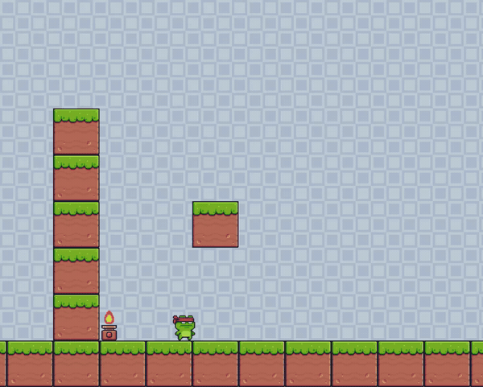

# 🐸 Python Platformer

Python과 **pygame**으로 만든 2D 횡스크롤 플랫포머 게임입니다.
닌자 개구리를 조작해 블록 위를 점프하고, 불 함정을 피하며 맵을 탐험합니다.



> 이 프로젝트는 유튜브 파이썬 플랫포머 제작 영상을 따라 만든 학습용 프로젝트입니다.
> 참고한 영상: [Python Platformer Game Tutorial for Beginners](https://youtu.be/6gLeplbqtqg) (freeCodeCamp.org, 강의 제작: Tech With Tim)
> 기본 구조는 영상을 따랐고, 아래 "직접 수정한 부분"을 추가·변경했습니다.

## 직접 수정한 부분

- 플레이어 캐릭터를 MaskDude에서 **NinjaFrog**로 변경
- 마스크 충돌(`collide_mask`)을 **히트박스 사각형 충돌**(`hitbox.colliderect`)로 교체 (캐릭터 몸통에 맞춰 좌우 12px, 위 8px 축소)
- `H` 키로 히트박스를 표시하는 **디버그 모드** 추가
- 왼쪽으로 이동할 때 화면 스크롤이 어긋나던 조건 수정
- 맵 구성 단순화 (바닥, 왼쪽 벽, 블록, 불 함정)

## 주요 기능

- **스프라이트 애니메이션**: 대기(idle), 달리기(run), 점프(jump), 더블 점프(double jump), 낙하(fall), 피격(hit) 동작을 시트에서 잘라 재생하고, 좌우 방향에 맞게 이미지를 반전합니다.
- **더블 점프**: 공중에서 한 번 더 점프할 수 있습니다.
- **횡스크롤 카메라**: 플레이어가 화면 가장자리(좌우 200px)에 가까워지면 화면이 따라 움직입니다.
- **불 함정**: 불에 닿으면 피격 애니메이션이 재생됩니다.
- **히트박스 충돌 판정**: 이미지 전체가 아닌, 캐릭터 몸통에 맞춘 사각형 히트박스(`hitbox.colliderect`)로 충돌을 처리해 모서리에 덜 걸리고 움직임이 부드럽습니다.
- **디버그 모드**: `H` 키로 히트박스를 화면에 표시하거나 숨길 수 있습니다.

## 조작법

| 키 | 동작 |
| --- | --- |
| `←` / `→` | 왼쪽 / 오른쪽 이동 |
| `Space` | 점프 (공중에서 한 번 더 누르면 더블 점프) |
| `H` | 히트박스 표시 켜기 / 끄기 |

## 실행 방법

### 1. 요구 사항

- Python 3.13 권장 (3.15 등 개발 단계 버전은 pygame 설치 파일이 없어 설치에 실패할 수 있습니다.)
- pygame

```bash
python -m pip install pygame
```

### 2. 실행

`assets` 폴더가 있는 위치에서 실행해야 이미지를 찾을 수 있습니다.

```bash
git clone <저장소 주소>
cd <저장소 폴더>
python mygame1.py
```

## 폴더 구조

```
.
├── mygame1.py      # 게임 본체
├── README.md
└── assets/
    ├── MainCharacters/NinjaFrog/   # 플레이어 스프라이트
    ├── Terrain/Terrain.png         # 블록 이미지
    ├── Traps/Fire/                 # 불 함정 스프라이트
    └── Background/Blue.png         # 배경 타일
```

## 코드 구조

| 구성 요소 | 설명 |
| --- | --- |
| `load_sprite_sheets()` | 폴더의 스프라이트 시트를 프레임 단위로 잘라 2배 확대하고, 필요하면 좌우 반전본까지 만듭니다. |
| `Player` | 이동, 점프, 중력, 애니메이션, 히트박스 동기화를 담당합니다. |
| `Block`, `Fire` | 맵을 구성하는 오브젝트입니다. 불은 애니메이션으로 켜지고 꺼집니다. |
| `handle_move()` | 키 입력 처리와 좌우·상하 충돌 검사를 수행합니다. |
| `get_background()`, `draw()` | 배경 타일을 채우고 화면을 그립니다. |
| `main()` | 게임 루프(입력 → 업데이트 → 그리기 → 스크롤)를 실행합니다. |

## 개선 계획

- [ ] 맵 확장 및 여러 스테이지
- [ ] 불 함정 외의 장애물, 적 추가
- [ ] 체력, 점수, 게임 오버 화면
- [ ] 배경음악과 효과음

## 에셋 출처

- 게임 구조와 기본 코드: 위에 적은 유튜브 영상을 참고했습니다.
- 게임 이미지(캐릭터, 지형, 함정, 배경): 튜토리얼에서 제공한 [에셋](https://github.com/techwithtim/Python-Platformer/tree/main/assets)을 사용했습니다. 에셋의 라이선스는 원작자의 안내를 따릅니다.

